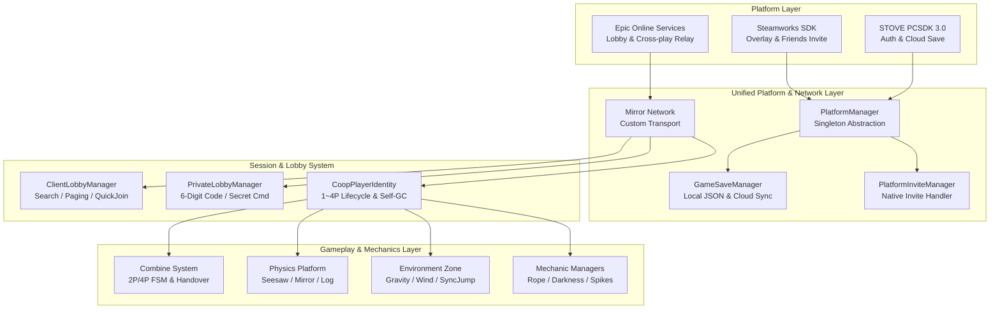

# BackTogether - Core Architecture & Network Showcase

[](https://store.steampowered.com/app/5086830/BACK_TOGETHER/)
[](https://unity.com/)
[](https://mirror-networking.com/)
[](#)

> **2~4인 온라인 협동 퍼즐 플랫포머 게임 'BackTogether'의 코어 아키텍처 및 네트워크 시스템 포트폴리오 저장소입니다.**  
> 본 저장소는 팀장(Hukaziroh / Bae)이 직접 설계하고 구현한 **멀티플레이 네트워크 엔진, 플랫폼 SDK 통합(Steam/STOVE/EOS), 복합 협동 기믹 및 트러블슈팅 코드**를 엄선하여 구성되었습니다.

---

## Repository Purpose & Security Notice (보안 및 저작권 안내)
* **상용 출시 보호**: 본 게임은 **2026년 10월 30일 Steam 정식 출시 예정작 (AppID: 5086830)**으로, 상용 에셋, 레벨 디자인 씬 파일(`.unity`), 타 팀원의 리소스는 저작권 보호를 위해 제외되었습니다.
* **민감 정보 검수 완료**: EOS Product/Sandbox/Deployment ID, Client Secret, STOVE Application Key 등 실제 서비스 인증 정보 및 Secret Key는 전수 검수하여 배제되었으며, 코드 구조와 아키텍처 중심으로 공개되어 있습니다.

---

## 담당 역할 (Role & Responsibility)
* **직책**: 팀장 (Team Leader) & 테크니컬 리드 (Technical Lead / Main Programmer)
* **기여 내용**:
  1. **프로젝트 기획 및 룰 설계**: 2~4인 협동 퍼즐 메커니즘 기획, 정규 6개 챕터 및 EX 스테이지/하드코어 모드 설계
  2. **크로스플랫폼 네트워크 아키텍처**: Mirror + Epic Online Services(EOS) 기반 세션 및 로비 시스템 구축
  3. **네이티브 플랫폼 SDK 연동**: Steamworks(스팀 친구 초대/업적) & STOVE PCSDK 3.0(인증/클라우드 세이브) 통합 추상화 레이어 개발
  4. **코어 협동 기믹 프로그래밍**: 2인/4인 합체(Combine), 시소/거울 물리 플랫폼, 환경 Zone 기믹 개발
  5. **동기화 최적화 & 트러블슈팅**: 호스트 방폭 방어, 비정상 이탈 세션 GC, 물리 지터링 제거 및 프레임 최적화

---

## 시스템 아키텍처 (System Architecture)



---

## 디렉토리 구조 (Directory Structure)

```bash
BackTogether-Core/
├── Network/                # 플레이어 라이프사이클 및 연결 안정성 관리
│   ├── CoopPlayerIdentity.cs       # 1~4P 번호표/색상 동기화 및 타임아웃 방어 GC 로직
│   ├── CoopPlayerManager.cs        # 활성 플레이어 추적 및 캐싱
│   ├── HostDisconnectHandler.cs    # 호스트 방폭(Disconnect) 시 클라이언트 안전 복구
│   ├── CoopLateJoinHandler.cs      # 중도 참여자 위치 및 씬 진행도 동기화
│   ├── CoopCheckpoint.cs           # 체크포인트 동기화
│   └── CoopBlockWall.cs            # 챕터 진행 차단벽 동기화
│
├── Lobby/                  # Mirror + EOS 기반 로비 및 매치메이킹 시스템
│   ├── ClientLobbyManager*.cs      # 공개 방 검색, 8개 단위 페이징, 챕터 필터링, 퀵조인 (Partial 분할 구조)
│   ├── PrivateLobbyManager*.cs     # 6자리 숏코드 비공개 방, 챕터 선택, 이스터에그 커맨드
│   ├── ClientJoinUI.cs             # 룸 목록 렌더링 및 인터랙션
│   ├── PlatformInviteManager.cs    # 스팀 친구 초대 수락 시 인게임 자동 접속 처리
│   └── NetworkSafeQuitHandler.cs   # 방 퇴장 및 프로세스 종료 시 소켓 클린업
│
├── PlatformSDK/            # Steam / STOVE 크로스플랫폼 통합 레이어
│   ├── PlatformManager.cs          # 플랫폼 API를 단일 창구로 추상화한 매니저 (싱글톤)
│   ├── GameSaveManager.cs          # 로컬 JSON 세이브 및 STOVE 클라우드 세이브 연동
│   ├── STOVEPCSDK3Manager.cs       # STOVE SDK 초기화, 업적 및 콜백 루프
│   └── EosApiKey.cs                # EOS 설정 ScriptableObject 정의
│
├── Gimmicks/               # 코어 2~4인 협동 퍼즐 및 물리 메커니즘
│   ├── Combine/                    # [핵심] 2인/4인 캐릭터 결합(합체) FSM 및 권한 위임
│   │   ├── PlayerCombineHandler.cs
│   │   ├── CoopDuoCombineTrigger.cs
│   │   └── CoopQuadCombineTrigger.cs
│   ├── Platform/                   # 시소, 양방향 거울, 순환 통나무 등 물리 플랫폼
│   ├── Zone/                       # 중력 역전, 강풍 존, 동기화 점프, 블리자드 환경
│   ├── Button/                     # 다중 협동 버튼, 영구 개방 브릿지 버튼
│   ├── Manager/                    # 로프 액션, 시야 제한(Darkness), 스파이크 타이머 매니저
│   └── Traps/                      # 수리검 함정, 타이머 스파이크 게이트, 보스 충돌
│
└── Common/                 # 제네릭 싱글톤 및 유틸리티 베이스
    └── Singleton.cs
```

---

## 핵심 기술적 성과 및 트러블슈팅 (Key Challenges & Solutions)

### 1. 호스트 방폭(Host Disconnect) 및 유령 세션 문제 해결
* **문제 상황**: P2P 릴레이 환경에서 방장이 게임 도중 강제 종료(Alt+F4)하거나 방을 폭파했을 때, 참여 중이던 클라이언트들의 세션 정보가 메모리에 남아 재접속 시 소켓 충돌이 발생하거나 무한 로딩에 빠지는 현상 발생.
* **해결 방안**:
  * `HostDisconnectHandler` 및 `NetworkSafeQuitHandler`를 구현하여 호스트 이탈 신호 수신 즉시 비동기 소켓 연결을 안전하게 Flush하고 상태 머신을 초기화.
  * `CoopPlayerIdentity`에 **자체 가비지 컬렉션(GC) 방어 로직**을 추가하여, 서버 접속 명단(`NetworkServer.connections`)에 없는 유령 클라이언트 ID를 주기적으로 탐색해 번호표 테이블을 자동 회수하도록 설계.

### 2. 2인 / 4인 합체(Combine) 기믹의 멀티플레이 동기화 및 예외 처리
* **문제 상황**: 여러 명의 플레이어가 하나의 캐릭터로 합체할 때, 조작 주도권(Input Authority) 충돌과 물리 연산 간섭, 합체 도중 한 명이 네트워크 튕김으로 나갔을 때 나머지 플레이어가 굳어버리는 프리징 이슈 발생.
* **해결 방안**:
  * 결합 상태 머신(FSM)을 정의하여 메인 조작 플레이어와 종속 플레이어의 입력/물리 제어권을 명확히 분리 (`PlayerCombineHandler`).
  * `OnStopClient` 이벤트와 결합 해제 트리거를 연동하여, 합체 도중 특정 유저가 이탈하거나 피격당하면 즉시 결합을 안전 해제(Rollback)하고 물리 상태를 원상 복구하는 안전 폴백 루틴 구축.

### 3. 이동 플랫폼 탑승 시 발생하는 물리 지터링(Jittering) 최적화
* **문제 상황**: Mirror 네트워킹의 Transform 동기화와 Unity Rigidbody2D 물리 틱 간의 업데이트 주기 차이로 인해, 움직이는 플랫폼 탑승 시 플레이어 스프라이트가 미세하게 떨리는 병목 발생.
* **해결 방안**:
  * 플랫폼 자체의 위치 보간(Interpolation)을 물리 FixedUpdate 주기에 맞추어 단일화하고 불필요한 이중 보간 삭제.
  * 플레이어가 플랫폼과 접촉 시 상대 속도 벡터를 보정해 주는 감지 트리거(`PlatformDetector`)를 적용하여 144Hz 고주사율 환경에서도 부드러운 탑승감 달성.

---

## Tech Stack
* **Engine**: Unity 2022.3+ (URP, 2D Feature Set)
* **Language**: C# (.NET Standard 2.1)
* **Networking**: Mirror, Epic Online Services (EOS) Relay
* **Platform SDKs**: Steamworks.NET, Stove PCSDK 3.0
* **Input**: Unity New Input System (Keyboard & Gamepad Support)

---
*개발 기간: 2026.06 ~ 2026.09 (정식 출시: 2026.10.30)*
